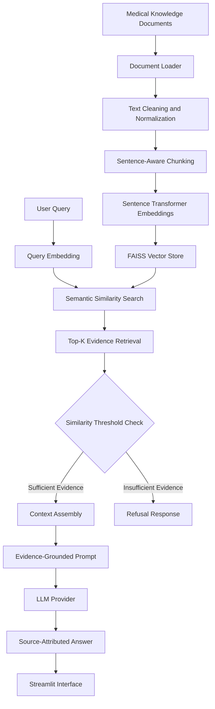

# MedRAG – Retrieval-Augmented Clinical Question Answering

**An evidence-grounded clinical question-answering system powered by Retrieval-Augmented Generation (RAG), semantic search, and medical knowledge bases.**

MedRAG is an NLP-based application that retrieves relevant information from medical reference documents and generates context-aware answers using Large Language Models (LLMs). It combines Sentence Transformers and FAISS for semantic retrieval with an LLM generation pipeline to provide source-attributed responses and reduce unsupported medical claims.

The system includes document ingestion, semantic indexing, relevance filtering, evidence-grounded generation, source citations, and an interactive Streamlit interface.

---

## Overview

Traditional LLM-based question-answering systems can generate inaccurate information, lack reliable source references, and respond confidently to questions outside their knowledge domain.

MedRAG addresses these challenges through a Retrieval-Augmented Generation architecture that grounds generated responses in a curated collection of medical reference documents.

**Core capabilities:**

- Semantic retrieval of relevant medical information.
- Context-aware answer generation using LLMs.
- Source attribution with document names and page references.
- Similarity-based relevance filtering.
- Insufficient-evidence detection for unsupported queries.
- Quantitative evaluation of retrieval and answer quality.

## Key Features

### 1. Medical Document Processing
- Supports PDF, Markdown, and TXT documents.
- Extracts and normalizes text while preserving important medical terminology.
- Implements sentence-aware chunking with configurable overlap.
- Maintains document and page-level metadata.

### 2. Semantic Search and Retrieval
- Generates dense embeddings using Sentence Transformers.
- Uses FAISS for efficient similarity-based retrieval.
- Implements cosine similarity using normalized vectors.
- Retrieves the top-K relevant evidence chunks.
- Applies a similarity threshold to filter irrelevant results.

### 3. Evidence-Grounded Answer Generation
- Integrates multiple LLM providers through a unified abstraction layer.
- Generates answers using retrieved medical context.
- Uses structured prompts to restrict unsupported responses.
- Provides source references for generated answers.

### 4. Hallucination Mitigation
- Similarity-based evidence validation.
- Context-constrained generation.
- Source attribution and traceability.
- Safety filters for sensitive clinical requests.
- Refusal mechanism when sufficient evidence is unavailable.

### 5. Interactive Dashboard
- Streamlit-based user interface.
- Clinical question-answering interface.
- Evidence inspection with source metadata.
- Interactive presentation of retrieved information.

### 6. Evaluation Framework
- Precision@K
- Recall@K
- Hit Rate@K
- Mean Reciprocal Rank (MRR)
- Faithfulness evaluation
- Reference F1 and baseline comparison

---

## System Architecture

MedRAG follows a modular Retrieval-Augmented Generation pipeline consisting of document processing, embedding generation, vector indexing, semantic retrieval, and evidence-grounded response generation.



### Processing Workflow

1. **Document Ingestion:** Medical reference documents are loaded from the knowledge base.
2. **Text Processing:** Extracted text is cleaned and divided into overlapping chunks.
3. **Embedding Generation:** Sentence Transformers converts chunks into 384-dimensional vector representations.
4. **Vector Indexing:** FAISS stores normalized embeddings for similarity-based retrieval.
5. **Query Processing:** User questions are converted into embeddings.
6. **Evidence Retrieval:** FAISS retrieves the top-K relevant chunks.
7. **Relevance Validation:** Retrieved evidence is checked against a configurable similarity threshold.
8. **Answer Generation:** The LLM generates a response using the retrieved evidence.
9. **Source Attribution:** The application displays supporting document references and evidence metadata.

---

## Technology Stack

| Component | Technology |
|---|---|
| Programming Language | Python 3.11+ |
| NLP Embeddings | Sentence Transformers |
| Embedding Model | all-MiniLM-L6-v2 |
| Vector Search | FAISS (IndexFlatIP) |
| Document Processing | PyPDF, PyMuPDF |
| LLM Integration | Groq, OpenAI, Gemini |
| Interface | Streamlit |
| Evaluation | Precision@K, Recall@K, MRR, Faithfulness, F1 |
| Testing | Pytest |

---

## Repository Structure

```text
medical_rag/
│
├── app/
│   ├── config.py
│   │
│   ├── ingestion/
│   │   ├── loaders.py
│   │   ├── cleaner.py
│   │   └── chunker.py
│   │
│   ├── embeddings/
│   │   └── embedder.py
│   │
│   ├── vectorstore/
│   │   └── faiss_store.py
│   │
│   ├── retrieval/
│   │   └── retriever.py
│   │
│   ├── generation/
│   │   ├── llm.py
│   │   └── prompts.py
│   │
│   ├── rag/
│   │   └── pipeline.py
│   │
│   ├── evaluation/
│   │   ├── retrieval_metrics.py
│   │   └── answer_metrics.py
│   │
│   └── utils/
│       └── logging_config.py
│
├── data/
│   ├── raw/
│   ├── processed/
│   └── evaluation/
│       └── questions.json
│
├── vector_store/
│   ├── medical.index
│   └── metadata.json
│
├── scripts/
│   ├── ingest_documents.py
│   ├── build_index.py
│   └── evaluate.py
│
├── tests/
│   ├── test_loaders.py
│   ├── test_chunking.py
│   ├── test_embeddings.py
│   ├── test_retrieval.py
│   ├── test_pipeline.py
│   └── test_evaluation.py
│
├── streamlit_app.py
├── requirements.txt
├── .env.example
├── .gitignore
```

---

## Installation and Setup

### Prerequisites

- Python 3.11 or later
- pip package manager
- Git
- API key for a supported LLM provider (optional when using mock mode)

### 1. Clone the Repository

```bash
git clone <(https://github.com/snehapatil82/clinical_rag_agent)>
cd "NLP Macro_proj"
```

### 2. Create a Virtual Environment

```bash
python -m venv venv
```

**Windows:**

```bash
venv\Scripts\activate
```

**Linux / macOS:**

```bash
source venv/bin/activate
```

### 3. Install Dependencies

```bash
pip install -r requirements.txt
```

---

## Configuration

Create a `.env` file using the provided environment template:

```bash
cp .env.example .env
```

Configure the required environment variables:

```env
# LLM Configuration
LLM_PROVIDER=groq
GROQ_API_KEY=your_groq_api_key
LLM_MODEL=openai/gpt-oss-120b
LLM_TEMPERATURE=0.1

# Embedding Configuration
EMBEDDING_MODEL_NAME=sentence-transformers/all-MiniLM-L6-v2

# Retrieval Configuration
TOP_K=4
SIMILARITY_THRESHOLD=0.38
```

**Supported LLM Providers:**
- Groq
- OpenAI
- Gemini
- Mock LLM Provider

The Mock LLM Provider supports offline demonstrations and automated testing without requiring an external LLM API key.

---

## Adding Medical Documents

Place medical reference documents inside the `data/raw/` directory.

Supported formats:

- PDF
- Markdown (.md)
- Text (.txt)

Example:

```text
data/raw/
├── asthma_management_guidelines.pdf
├── hypertension_clinical_guidelines.pdf
├── type2_diabetes_guidelines.pdf
├── cardiovascular_disease_prevention.pdf
└── community_acquired_pneumonia_guidelines.pdf
```

The ingestion pipeline extracts document content while preserving source metadata for traceability.

---

## Building the Vector Index

Execute the following command to process documents and generate the FAISS vector index:

```bash
python scripts/build_index.py
```

The indexing pipeline performs the following operations:

1. Loads medical documents from the raw data directory.
2. Extracts and cleans document text.
3. Splits content into overlapping chunks.
4. Generates normalized embeddings using Sentence Transformers.
5. Creates a FAISS IndexFlatIP vector index.
6. Stores the corresponding document metadata.

Generated files:

```text
vector_store/
├── medical.index
└── metadata.json
```

---

## Running the Application

Start the Streamlit application:

```bash
streamlit run streamlit_app.py
```

Open the application in your browser:

```text
http://localhost:8501
```

Enter a clinical question to retrieve relevant medical evidence and generate an evidence-grounded response.

---

## Evaluation and Performance

MedRAG includes an evaluation framework to assess retrieval effectiveness and answer quality.

The system was evaluated using a 26-question gold-standard benchmark dataset.

### Information Retrieval Performance

| Evaluation Metric | K = 1 | K = 3 | K = 5 |
|---|---:|---:|---:|
| Precision@K | 0.8846 | 0.8718 | 0.8308 |
| Recall@K | 0.4423 | 0.8846 | 0.8846 |
| Hit Rate@K | 0.8846 | 0.8846 | 0.8846 |
| MRR | 0.8846 | 0.8846 | 0.8846 |

### Baseline vs. Proposed RAG Approach

| Evaluation Dimension | Baseline (No-RAG) | Proposed RAG |
|---|---:|---:|
| Evidence Faithfulness | 0.0541 | 0.7391 |
| Source Citation Attribution | 0% | 100% |
| Out-of-Domain Handling | No evidence-based refusal | Insufficient-evidence refusal |

The evaluation demonstrates improved evidence alignment and source traceability compared with the baseline approach.

### Run Evaluation

Execute the benchmark evaluation script:

```bash
python scripts/evaluate.py
```

---

## Hallucination Mitigation and Safety Mechanisms

MedRAG incorporates multiple safeguards to improve the reliability of generated responses.

| Safeguard | Description |
|---|---|
| Relevance Thresholding | Rejects queries when the retrieved similarity score is below the configured threshold. |
| Context-Grounded Prompting | Restricts generated answers to the retrieved medical evidence. |
| Source Attribution | Provides document names, page numbers, similarity scores, and chunk identifiers. |
| Clinical Safety Filter | Identifies sensitive diagnostic and dosage-related requests and applies safety restrictions. |
| Faithfulness Evaluation | Evaluates the alignment of generated responses with retrieved evidence. |

When the retrieved evidence does not meet the configured relevance threshold of 0.38, the system returns an insufficient-evidence response rather than generating an unsupported answer.

---

## Testing

The project includes a Pytest-based testing framework covering the major system components.

```bash
pytest
```

Test coverage includes:

- Document loading and text cleaning.
- Text chunking and boundary handling.
- Embedding generation and vector normalization.
- FAISS retrieval and ranking.
- End-to-end RAG pipeline and refusal handling.
- Evaluation metric calculations.

---

## Limitations and Future Enhancements

### Current Limitations

- Dense-only retrieval may be less effective for specialized medical codes and rare terminology.
- Retrieved chunks are assembled without an additional cross-encoder reranking stage.
- Answer quality depends on the coverage and quality of the medical knowledge base.

### Future Scope

- **Hybrid Retrieval:** Combine BM25 keyword search with dense vector retrieval using Reciprocal Rank Fusion.
- **Cross-Encoder Reranking:** Improve evidence ranking by reranking retrieved candidate chunks.
- **Medical Knowledge Graph Integration:** Incorporate structured medical knowledge sources such as UMLS and SNOMED-CT.
- **Expanded Knowledge Base:** Support additional medical guidelines and reference documents.
- **Improved Evaluation:** Expand benchmark datasets and assess retrieval and generation quality across more clinical topics.

---

## Medical Safety Disclaimer

MedRAG is developed exclusively for academic research, educational purposes, and algorithmic evaluation.

It is not intended to provide medical advice, clinical diagnoses, treatment recommendations, or prescription guidance. The generated responses should not be used as a substitute for professional medical consultation.

All medical decisions should be made in consultation with qualified healthcare professionals.

---


**MedRAG – Making medical information retrieval more evidence-grounded, transparent, and traceable.**
